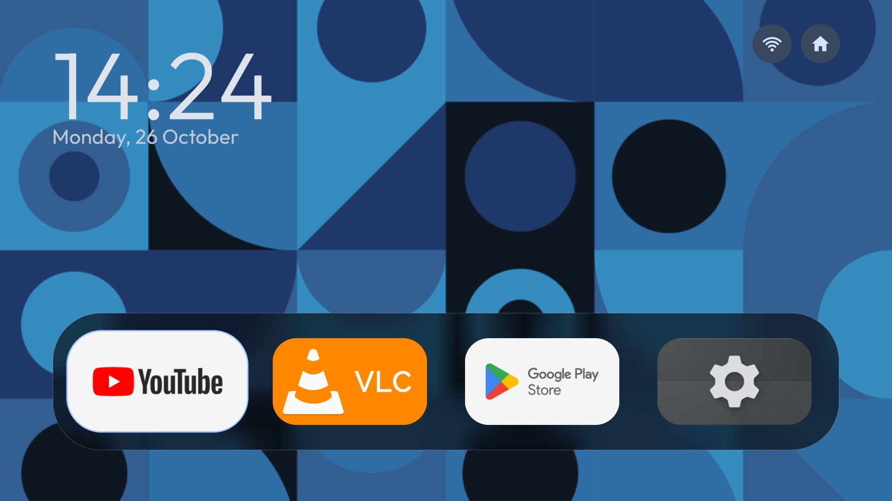
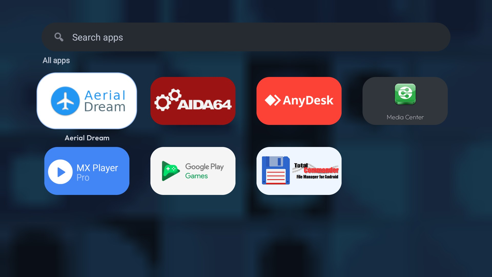
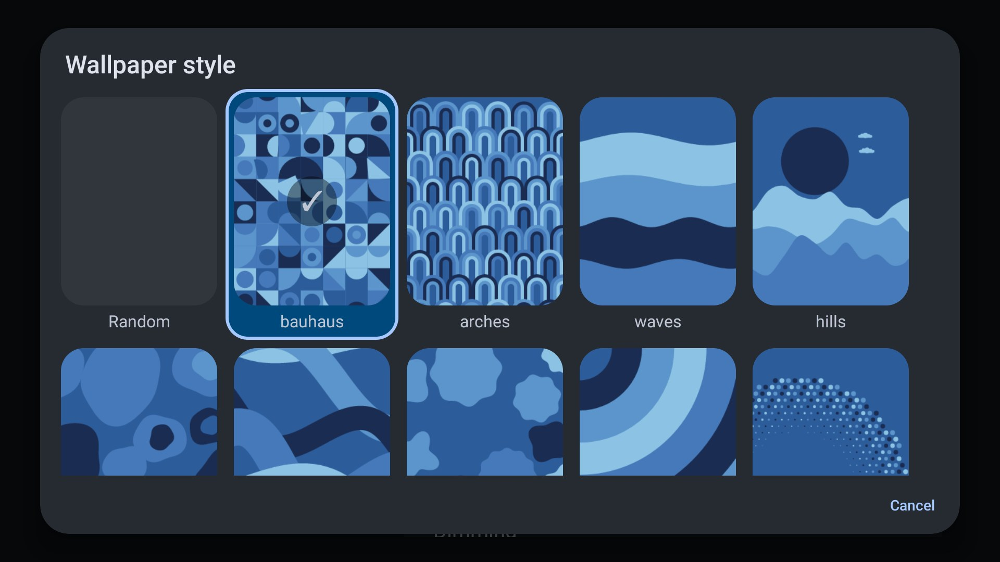

<p align="center"></p>

<h1 align="center">AHome</h1>

<p align="center">A Material 3 Expressive home screen for Android TV and Google TV, with animated generated wallpapers.<br>
Made by <b>uxazu</b>.</p>

<p align="center"></p>
<p align="center"> </p>

## What it is

AHome replaces the stock launcher on a TV. The home page is only your dock of favourite apps, a clock and the
weather; one press of Down opens a frosted page with a search field and every app.

- **Material 3 Expressive by default**: tonal surfaces, large rounded shapes, a primary-colour focus ring, spring motion.
- **Animated wallpapers**: 21 generated styles and 33 palettes (a port of the Wally / Nyri generators), drawn live on
  their own thread, frosted behind the panels. Pick them from a grid of live previews.
- **Fast on a weak TV**: wallpapers run on their own surface, the dock-only home keeps the first frame light, and a
  held remote key is paced so the list never outruns its animations.
- **Settings in the launcher**: wallpaper style, palette, resolution, blur, dimming, clock size, weather, dock apps.
- **Your language**: English by default, the interface follows the system language, and Settings → System → Language picks another one.
- No analytics, no accounts. The only network use is the optional weather line.

## Install

Requires Android 8.0 (API 26) or newer. Build the APK (see below) and sideload it:

```sh
adb connect <tv ip>:5555
adb install -r launcher/app/build/outputs/apk/release/app-release.apk
```

Then press Home and choose AHome as the default launcher.

## Build

JDK 17 and the Android SDK (platform 34, build-tools 34.0.0) are needed.

```sh
cd launcher
./gradlew assembleRelease
```

The APK is `launcher/app/build/outputs/apk/release/app-release.apk` (signed with the debug key, for sideloading).
Pass `-PlauncherApplicationId=your.package` to install under another package name.

## Languages

English (default), Arabic, Bengali, Catalan, Czech, Danish, German, Spanish, Finnish, French, Hebrew, Indonesian, Italian,
Japanese, Korean, Norwegian, Dutch, Polish, Portuguese, Russian, Serbian, Thai, Turkish, Ukrainian, Uzbek, Vietnamese and
Chinese. The settings screens of the newest version are translated for Spanish, German, French, Portuguese, Italian,
Chinese, Japanese, Korean, Turkish, Polish, Ukrainian and Russian; other languages show English there until someone
adds `values-xx/strings_ui.xml`. Translation fixes are welcome.

## Credits and licence

AHome is released under the MIT licence (see [LICENSE](LICENSE)). It started from the launcher of
[cleanyourtv](https://github.com/Gathin23/cleanyourtv) by Gathin (MIT). The wallpaper generators are a port of
[Wally](https://github.com/yzewe/Nyri) / Nyri; check their licence before redistributing the generated art. The
bundled Google Sans font (Latin and Cyrillic subsets) is under the SIL Open Font License (`launcher/FONT-LICENSE-OFL.txt`).

The site in `site/` is a static page built with [Material Web](https://github.com/material-components/material-web) (Apache-2.0), Google Sans (OFL) and Material Symbols (Apache-2.0), all self-hosted: it makes no requests to third-party servers.

